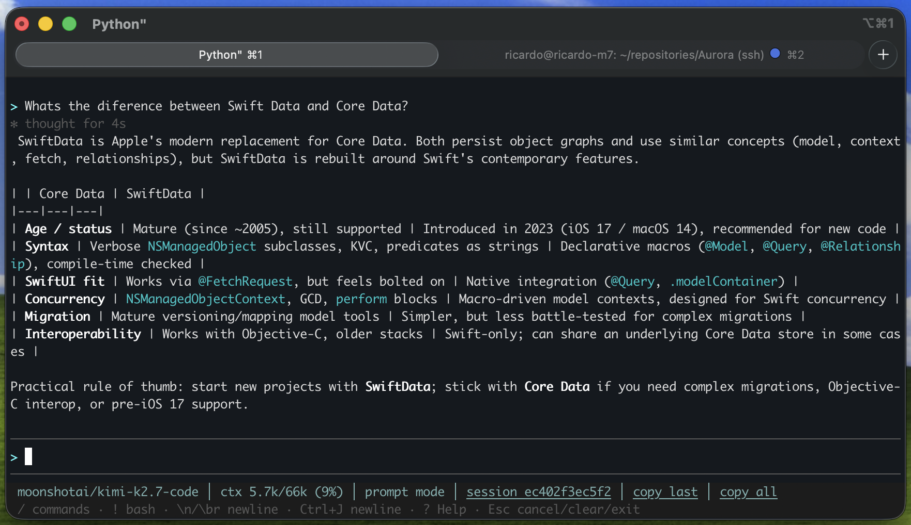
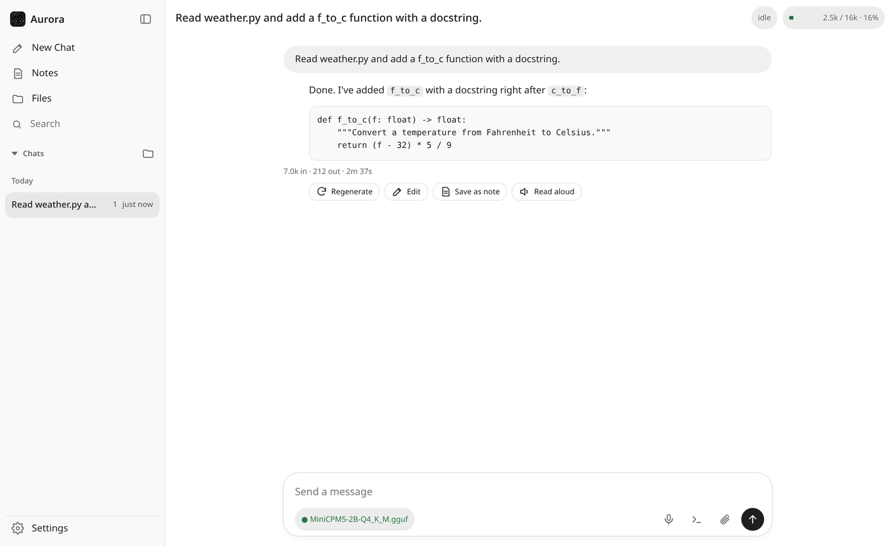

# Aurora


Aurora is a micro terminal coding agent. It talks to OpenRouter, a local
llama.cpp server or a local Ollama server, and has a tool loop, approval
prompts, session logs and MCP servers (set in `config.yaml` under
`mcp_servers:`).

> A micro terminal coding agent, small enough to read and complete enough to
> use every day. Named after my beautiful two-year-old daughter Aurora,
> always with her hair bow.



## Contents

- [Quick orientation](#quick-orientation)
- [Install](#install-macos-or-linux)
- [Keys](#keys)
- [Run](#run)
- [Web version](#web-version-aurora-lite)
- [Daily use](#daily-use)
- [Layout](#layout)
- [Tests](#tests)
- [Other documents](#other-documents)

## Quick orientation

Save a bootstrap prompt once and Aurora offers to run it every time it
starts, so each session begins already knowing the project. A good default
is in [`documents/bootstrap.example.md`](documents/bootstrap.example.md);
[documents/FEATURES.md](documents/FEATURES.md#session-bootstrap) explains how
to set it up.

In short, Aurora:

- scans every prompt and tool output for secrets before it reaches the model
  or a log;
- shows a preview of every write, edit or command and asks before running it,
  and takes a shadow git snapshot first, so `/rewind` can undo any step;
- has one `/model` menu for OpenRouter and a local llama.cpp or Ollama server;
  you add a model by pasting its URL;
- uses prompt caching and runs read-only tool calls in parallel, so a
  multi-step task doesn't burn tokens;
- runs as a full-screen TUI with streaming Markdown, collapsible thinking
  blocks and mouse support;
- can resume, export and `/compact` sessions;
- loads extensions from plain `.py` files (an MCP client and a lint checker
  are included).

[documents/FEATURES.md](documents/FEATURES.md) has the full details, the
screenshots and the reasons behind each feature.

## Install (macOS or Linux)

The easiest way is one line, from any folder:

```bash
curl -fsSL https://raw.githubusercontent.com/ricardopsantos/Aurora/main/bootstrap-install.sh | bash
```

It clones into `~/Aurora` (change it with `AURORA_DIR=/path ...`) and runs
`install.sh`. On a first install it also offers to set up an API key if you
don't have one yet. To do it by hand:

```bash
git clone https://github.com/ricardopsantos/Aurora.git Aurora
cd Aurora && ./install.sh     # asks for the data folder (default ~/.aurora)
                               # the first run also creates config.yaml from
                               # config.yaml.example if you don't have one,
                               # and offers to set up an API key if none is set
```

To update, run `git pull`, then `./.venv/bin/pip install -e . -q` if the
dependencies changed. `config.yaml` holds providers, models and endpoints.
Some checkouts commit a shared one and others ignore it as machine-specific;
either way, `./install.sh` creates it from `config.yaml.example` if it's
missing. Keys are never stored in the config. They live in environment
variables or the OS keyring, set with `aurora key set`.

## Keys

```bash
aurora key set                    # LLAMA_API_KEY (default)
aurora key set OPENROUTER_API_KEY  # openrouter.ai/keys
aurora key status                 # is a key set, and where from?
```

Without an OpenRouter key Aurora still works, but you can't use the paid
remote models; pick your local model with `/model`. A local llama.cpp or
Ollama server needs no key either (see the `ollama:` entry, `type: ollama`,
in `config.yaml.example`). The full key table, `key_fetch:` and `aurora wipe`
are in [documents/KEYS.md](documents/KEYS.md).

## Run

```bash
aurora                # start in the current project (knows nothing until you /bootstrap)
aurora --continue     # resume the last session
aurora --resume ID    # resume a specific session
aurora --classic      # inline REPL instead of the full-screen TUI
aurora -t "task"      # one-shot, no prompts; exit 0 ok / 1 incomplete / 2 usage error (see --man)
aurora my-config.yaml # alternate config
aurora --man          # full man-style manual
```

## Web version (Aurora Lite)

The same agent runs in a browser, on a desktop or a phone.



### Start it

```bash
export AURORA_WEB_TOKEN=$(openssl rand -hex 16)   # required; paste it into the page once
aurora --web                                      # http://127.0.0.1:9592
```

Options: `--bind ADDR`, `--port N`, `--workspace DIR` (default: the current
folder). Keep the loopback bind and put a TLS proxy in front. The page can
run tools, so read [SECURITY.md](SECURITY.md) first.

### What you get

- A sidebar of chats with search, rename, delete and drag-and-drop folders.
  You can download any chat as one HTML file.
- Markdown notes in Personal, Work and Skills tabs, with tickable `- [ ]`
  tasks. Type `#` in the message box to send a note to Aurora.
- Attach or drop files, including music and video up to 200 MB, and browse
  them under Input and Outputs with a preview.
- A Commands menu to resume a session, see the diff of the last turn, or
  undo it.
- Tap the model name to switch models, refresh prices or edit the model list.
  Aurora checks the list before saving and keeps the last 5 versions.
- A meter shows how full the context is, and the session clears itself at
  90%.
- Tool calls run without asking by default (auto-approve; the denylist still
  blocks). Turn it off in Settings > Chat and each call asks yes, no or stop.

### Three layouts

| URL | Style |
|---|---|
| `/` | Chat (default, like Open WebUI) |
| `/paper` | One narrow column with a menu drawer |
| `/v1` | The original desktop layout |

### Running it as a service

There is an example unit in `deploy/aurora-web.service.example`. After an
update, run `deploy/restart-web.sh`, or `deploy/install-hooks.sh` to restart
on every pull.

Optional extras switch themselves off when something is missing. Voice input
needs `ffmpeg` and a whisper server at `AURORA_WEB_STT_URL`. Skill folders
and MCP servers come only from your own `config.yaml`.

Details and requirement numbers are in [REQUIREMENTS.md](REQUIREMENTS.md).

## Daily use

[documents/COMMANDS.md](documents/COMMANDS.md) has the full command table,
the status bar layout and the rule for the Esc key (press it twice).

| Input | Action |
|---|---|
| plain text | talk to the model; writes and commands ask first |
| `/model` | switch between OpenRouter and local models |
| `/cost` · `/context [id]` | spend across all sessions · this session's cost tree |
| `/compact` · `/clear` · `/reset` | summarize and continue · start fresh · full reset |
| `/rewind [id]` | list or restore a checkpoint taken before an edit |
| `/resume` · `/search <text>` | pick a past session · find one by its content |
| Esc (twice) | cancel, leave a mode or quit |
| `?` or `/help` | open the help menu |

## Layout

The engine (state, providers, tools, agent loop) and the UI (a
prompt_toolkit REPL) are kept apart. The only contract between them is the
`Frontend` protocol in `aurora/frontend.py`, and `tests/test_architecture.py`
enforces the boundary. To swap the UI (HTML, websocket), implement
`Frontend`; the engine doesn't change. The full write-up is in
[documents/ARCHITECTURE.md](documents/ARCHITECTURE.md).

## Tests

```bash
./.venv/bin/python -m pytest -q
```

## Other documents

Everything except this README is in [documents/](documents/):

- [CHANGELOG_TECHNICAL.md](documents/CHANGELOG_TECHNICAL.md): the original
  spec, with requirements R1 to R293, the build plan and the test plan. It's
  kept as a record.
- [ARCHITECTURE.md](documents/ARCHITECTURE.md): how it's built. The
  engine/UI boundary, module map, data flow, threads and storage.
- [FEATURES.md](documents/FEATURES.md): every feature in detail, with
  screenshots.
- [COMMANDS.md](documents/COMMANDS.md): the full command table, the status
  bar and the Esc rule.
- [KEYS.md](documents/KEYS.md): the full key table and `key_fetch:`.
- [LOCAL_MODEL_NOTES.md](documents/LOCAL_MODEL_NOTES.md): using a local
  llama.cpp server.
- [EXTENSIONS.md](documents/EXTENSIONS.md): writing a `.py` tool extension.
- [MCP_SERVERS.md](documents/MCP_SERVERS.md): adding MCP servers to
  `config.yaml`.
- [REQUIREMENTS_OVERVIEW.md](documents/REQUIREMENTS_OVERVIEW.md): a short
  map of the requirement groups.
- [CHANGELOG.md](documents/CHANGELOG.md): release notes for people.
- [bootstrap.example.md](documents/bootstrap.example.md): the default
  bootstrap prompt.

At the repo root, [REQUIREMENTS.md](REQUIREMENTS.md) and the files under
[requirements/](requirements/) hold the current requirements (up to R440) as
testable rules. New requirements go there.

The README, the requirements and `ARCHITECTURE.md` must match the code. Any change in behaviour ships with its doc update in the same commit.
