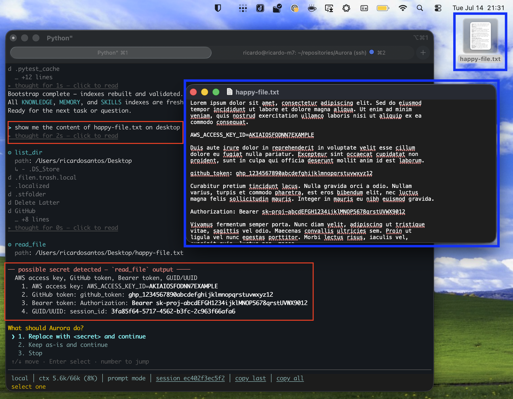
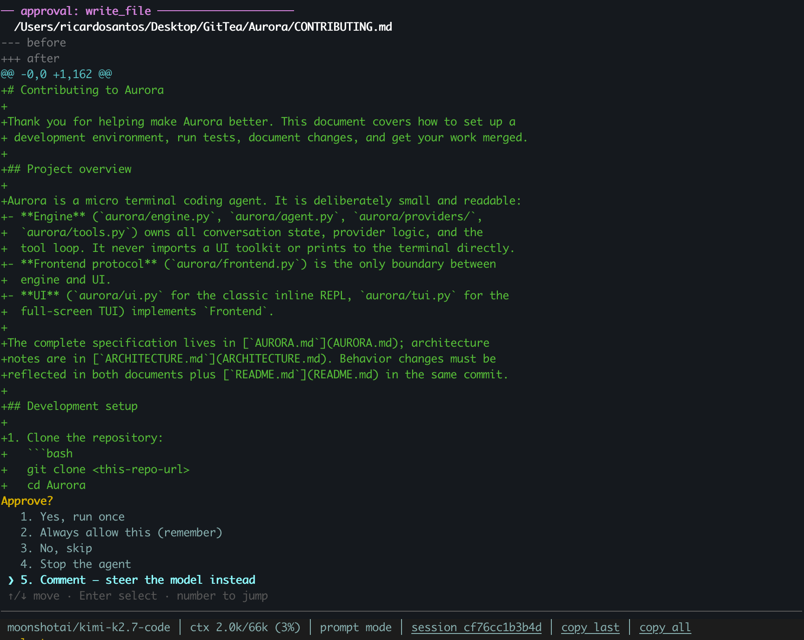
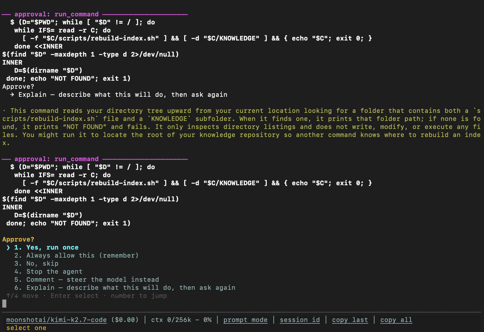
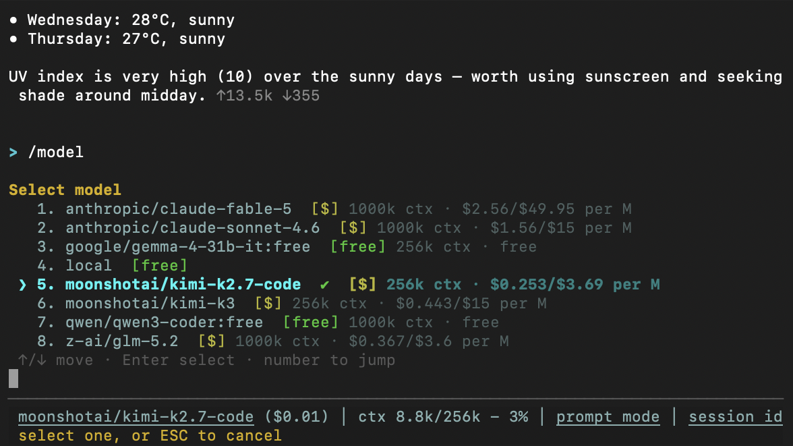
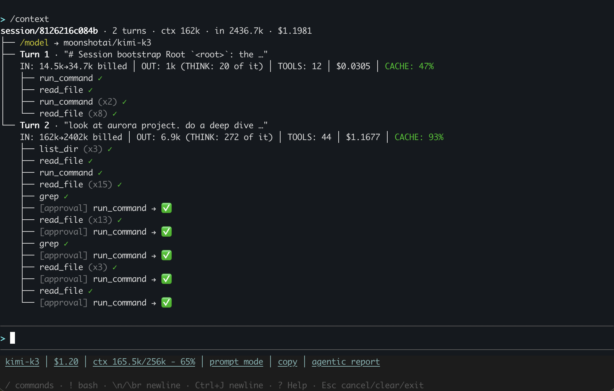
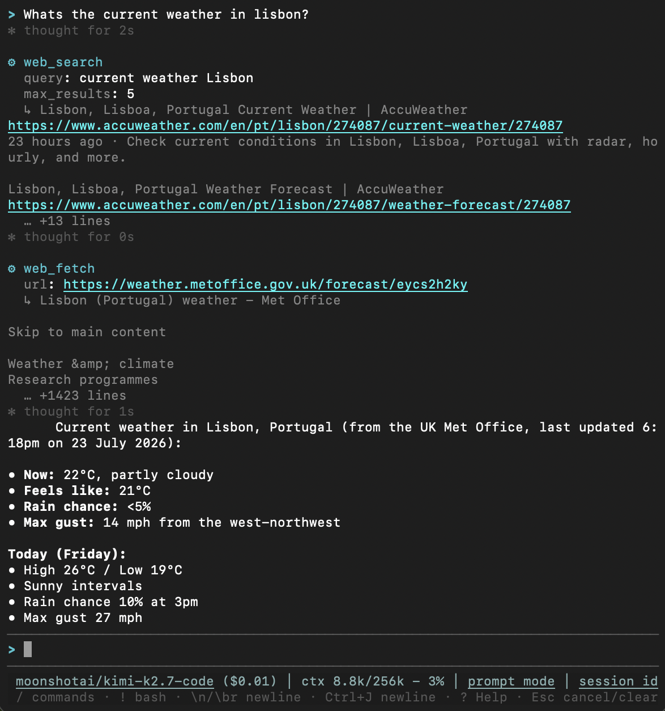
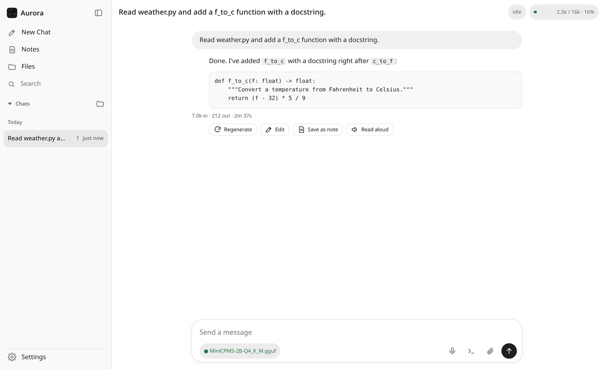

# Aurora features

The full detail behind the feature summary in the [README](../README.md).

## Session bootstrap

Save a bootstrap prompt once and Aurora offers to run it every time it
starts. The repo includes a good default,
[`bootstrap.example.md`](bootstrap.example.md). It reads the README and the
rules files, loads a project context folder (`.context/`) if there is one,
checks the git state, and reports a short brief before it touches anything.

```
/bootstrap set documents/bootstrap.example.md            # global default
/bootstrap set documents/bootstrap.example.md project    # just this project (.aurora/bootstrap.md)
```

## Privacy and security

- Aurora scans every prompt and every tool output for API keys, tokens and
  credentials before they reach the model or the session log. This includes
  read-only tools such as `read_file` and `grep`. When it finds one, you
  choose: redact it, keep it, allow it from now on, or stop. Source code and
  ordinary names are skipped, so the scan doesn't flag a variable called
  `token`.
- API keys are never stored on disk in plain text. They live in the OS
  keyring or in encrypted storage.



## Approvals and edits

- Every file write, edit or shell command shows a diff preview and asks
  first.
- At the prompt you can allow once, allow for this session only (nothing is
  saved), always allow, or always deny. The prompt shows the exact rule that
  "always" would save.
- Instead of allowing or denying, pick "Comment" and type a note. Aurora adds
  it to the same request and redoes the change, so you don't have to deny,
  explain again and approve again.
- Aurora takes a shadow git snapshot before every approved change, so
  `/rewind` can undo any step, even the rewind itself.



Pick "Explain" and Aurora describes in plain English what the pending call
will do, then asks again. This helps with a command you don't recognize.



### How "always allow" decides what it covers

A saved rule covers more or less depending on how risky the command is.

- A read-only command (`find`, `ls`, `grep` and similar) is saved for any
  arguments, so approving `find /a` also covers `find /b` next time. The
  exception is a call that uses one of the command's own writing flags. `find`
  has `-delete`, `-exec` and `-fprintf`, so a `find` with one of those is
  treated as destructive. An "always allow" on `find . -name '*.log'` can
  never let `find / -delete` through.
- A destructive command (`dd`, `rm`, `mkfs`, `shred`, `sudo`, `sh`, `bash`,
  `python`, `curl`, `wget` and similar) is saved only as that exact command.
  Approving `rm -rf ./build` never lets `rm -rf /` through.
- Anything with a shell operator (`&&`, `|`, `>`, a backtick, `$(`) is also
  saved only as the exact command.
- Everything else is saved by its first two words, such as `git push`.

To block a pattern for good, pick "Always DENY this" at any prompt or edit
`denylist.yaml`. A deny rule always wins. `/denylist` lists the deny rules.
`/allowlist audit` lists allow rules that are duplicates or too broad by
today's rules, and `/allowlist prune` removes them after you confirm.

### Plan mode, trials and spending caps

- `/plan on` lets Aurora read, search and fetch but refuses every write,
  edit, command and MCP tool, even ones an allow rule or `/auto-approve`
  would run. The model writes those steps into its plan instead. It is off
  at start and shows as `✎ plan mode` on the status bar.
- `/try <task>` runs the task in a throwaway git worktree, a copy of your
  current tree including uncommitted changes. When it's done you see the
  diff and choose apply, discard or keep. Your real tree doesn't change
  until you apply. It needs a git repo with at least one commit.
- `/budget <usd>` caps spending for the session, and `/budget day <usd>`
  caps each day across sessions. Aurora warns once at 80% and stops calling
  paid models at 100%. Both are off by default; only models with a price
  count.

## Any model

- `/model` switches between OpenRouter (paid) and your own local server
  (llama.cpp, or Ollama with a `type: ollama` provider entry), from the same
  arrow-key menu. The current model is marked. If a key is missing, Aurora
  asks once and remembers it; a local server usually needs none.
- To add a model, paste its OpenRouter URL:
  `/model add https://openrouter.ai/kwaipilot/kat-coder-air-v2.5` (or just
  `org/model`). Aurora checks it against the OpenRouter catalog, fetches its
  context size, price and description, and asks for your
  `OPENROUTER_API_KEY` if it isn't stored yet. The picker also has an
  "+ add a model…" row. `/model remove` drops one. Automatic setup works for
  OpenRouter models only.
- A local server that has unloaded its model to save memory shows as
  "asleep". Aurora tells you before the first, slower reply wakes it. When a
  server can't be reached, Aurora explains the likely cause and what to try.



## Saving tokens

- Aurora marks the system prompt (your rules, indexes and `[CORE]` docs) as
  cacheable, so the long preamble isn't billed again on every tool step of
  every turn. That repeat billing is where a multi-step task spends most of
  its money. `/cost` shows the cost per model, cache hits included.
- The read-only calls in a step (reads, greps, fetches) run at the same
  time instead of one after another. Approvals, ordering and the transcript
  stay the same; only the waiting overlaps.
- `grep` takes real regular expressions and `read_file` takes a line range,
  so the model can go straight to the part it needs.

```
> /cost
token usage — all sessions
  local
    1 turn · in 500 · out 80 · no price
  moonshotai/kimi-k2.7-code
    1 turn · in 41k · out 1.2k · $0.0148  32k cached
  total  $0.0148
```

`in` is the billed prompt total. Every tool step of a turn pays for the whole
context again, which is why caching matters. Prices come from a per-model
table you can edit. A model with no entry says "no price" rather than
`$0.00`, which would suggest it was free.

`/context` shows the same numbers per turn instead of per model: every tool
call, approval and cache hit rate in one session.



## Daily terminal use

- A full-screen TUI with a scrollable chat, streaming Markdown, syntax
  highlighting in code blocks (Python, JS/TS, Bash, Go, Rust, Ruby), timed
  collapsible thinking blocks, mouse support and drag-to-copy. Plain
  terminals get a classic REPL instead.
- Keep typing while the model works. Enter queues your line as the next
  prompt. Ctrl+Enter sends it into the running turn, so you can steer it
  without stopping it. Typing `stop` cancels the turn.
- The status bar shows the average generation speed (tokens per second).
  A model that keeps repeating the same call is stopped after three rounds.
- Resume past conversations, export them as Markdown, or `/compact` long ones
  into a summary.
- Reusable skills, plus a per-project bootstrap prompt so each session starts
  already knowing the codebase.
- [Extensions](EXTENSIONS.md): drop a `.py` file into
  `~/.aurora/extensions/` and its tools become available to the model. It
  uses the same `SPEC`/`RUNNERS` shape as Aurora's built-in tools. Four
  extensions come bundled:
  - `web_search` and `web_fetch`, so the model can look things up instead of
    guessing. `web_fetch` returns readable text.
  - An MCP (Model Context Protocol) client. Point `mcp_servers:` in
    `config.yaml` at any stdio MCP server and its tools appear next to
    Aurora's own, behind the same approval prompt.
  - `lint_check`, which runs `ruff` on a Python file the model just wrote
    or edited.
  - `refresh_model_prices`, which fetches the current price and context size
    of every configured OpenRouter model.



## Headless one-shot mode

`aurora -t "task"` (or `-t -` to read the task from stdin) runs one turn and
exits without asking anything. Allowlisted tools run and everything else is
denied; `--yes` approves the rest, but never anything on the denylist.
stdout gets only the answer and progress goes to stderr.

Exit codes: 0 means finished, 1 means incomplete (a denied call, the step
limit from `--max-steps`, a detected secret, or a provider error), and 2 means
a usage or config error. The session is logged like any other, so
`aurora --resume ID -t "…"` continues it.

`--json` prints one JSON object on stdout instead, with `ok`, `exit_code`,
`reply`, `reasons`, `model`, `session`, `cost_usd`, `context_tokens` and
`tool_calls`, for scripts and other agents.

## Web version (Aurora Lite)

`aurora --web` serves the same engine as a chat page for a browser on a
desktop or a phone. The README has the
[setup steps](../README.md#web-version-aurora-lite).



- Chats: a sidebar with search, rename, delete and drag-and-drop folders.
  Each row shows how many messages were sent. You can open on the last chat
  instead of a new one, and download any chat as one HTML file, either just
  the prompts and answers or everything including thinking and tool output.
- Sending: you can send several messages without waiting; they run one at a
  time, in order. Commands next to Send let you resume a session, see the
  diff of the last turn, or undo it. Replies have Regenerate, Edit, Save as
  note and Read aloud.
- Notes: Markdown notes in Personal, Work and Skills tabs, with tickable
  `- [ ]` tasks and an Edit / View switch. Drag a note to reorder the list.
  Type `#` in the message box to send a note to Aurora as context.
- Files: attach or drop documents, pictures, music and video (up to 200 MB).
  Documents go to Aurora as text and pictures go to vision models. Music and
  video are stored unchanged and Aurora gets their path. The Files section
  has Input and Outputs tabs with a preview for common file types and
  Prev/Next to move through them.
- Models: tap the model name to switch, wake a sleeping local model, refresh
  OpenRouter prices, or edit `config.yaml` and `config.local.yaml` as YAML.
  Aurora checks the YAML before saving, keeps the last 5 versions, and never
  shows your keys.
- Context: the top bar always shows the context meter, the token count and
  how many times the chat was compacted. A turn that ends with the context
  90% full starts the next one fresh.
- Voice: speak your message, or have replies read aloud, with one Language
  setting for both. Voice input needs `ffmpeg` and a whisper server.
- The page works offline for what's already loaded, can be added to a
  phone's home screen, and has light and dark themes.

Safety in the web version works differently from the terminal. A session
starts with auto-approve on, so tool calls run without asking; the denylist
still blocks what it lists. You can turn it off in Settings, under Chat, where
there is also a Plan mode switch. With auto-approve off, each call asks yes, no or stop, and no answer within
10 minutes counts as no. Every API call needs the `AURORA_WEB_TOKEN` bearer
token. Anyone with the token can run commands through Aurora, so keep it out
of git and chat, keep the default loopback bind, and put a TLS proxy in
front. See [SECURITY.md](../SECURITY.md).

There are two other layouts: `/paper`, one narrow column with a menu drawer,
and `/v1`, the original desktop layout.
